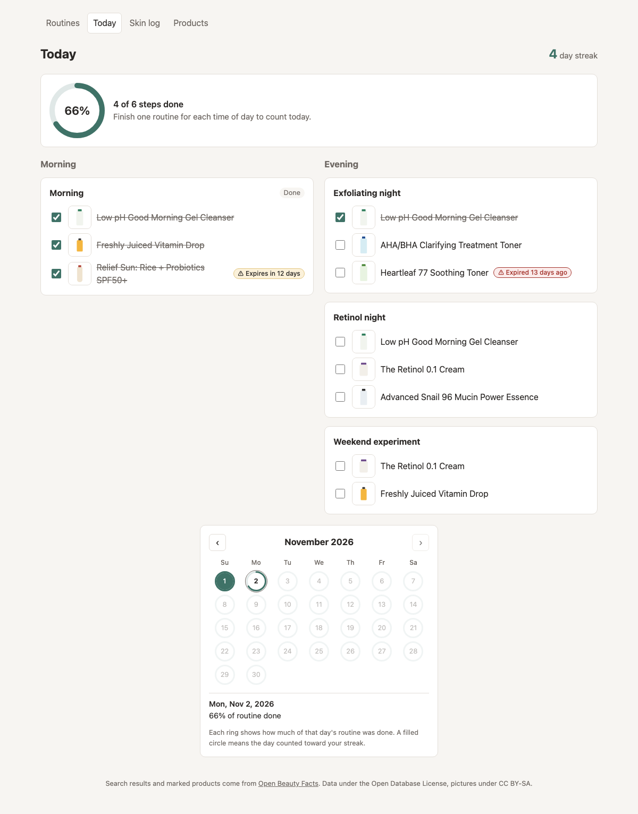
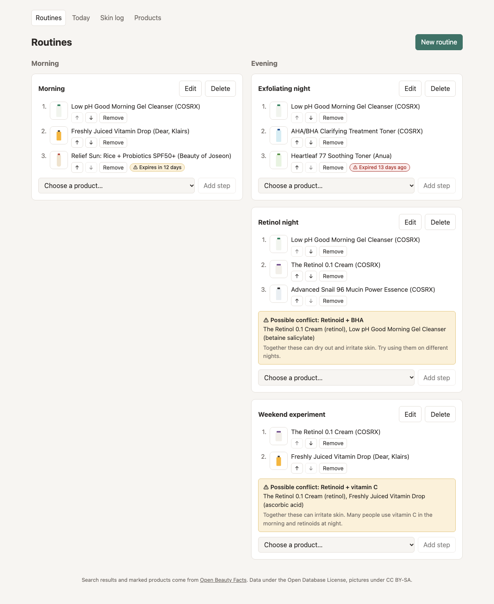
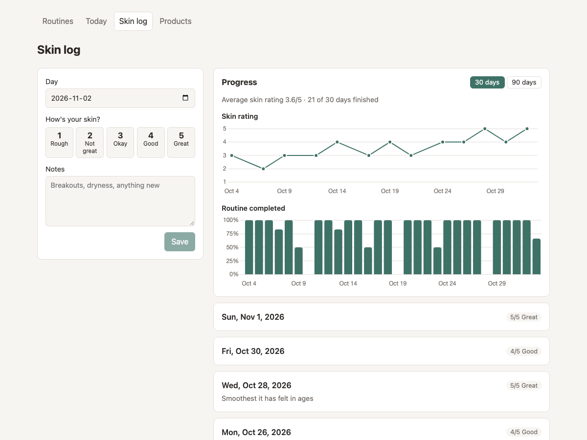
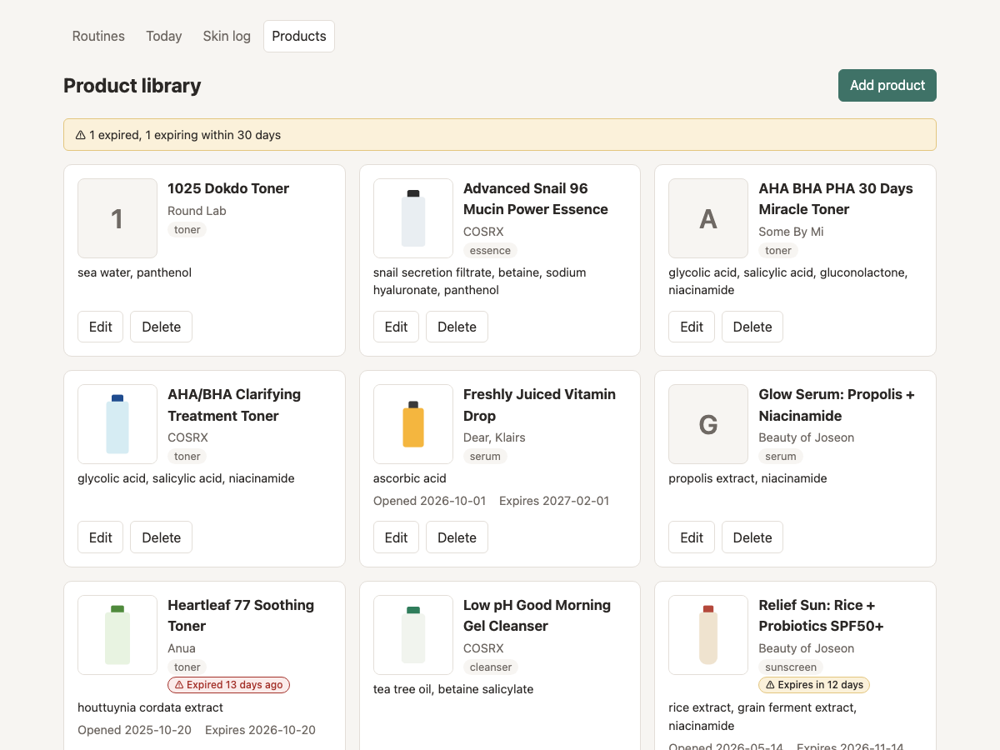
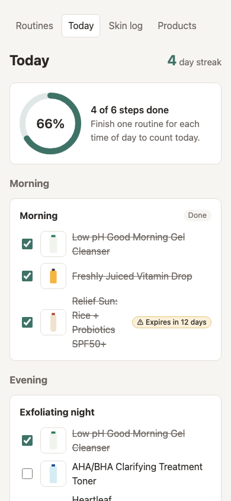

# Skincare Routine Tracker

A personal web app for building skincare routines, ticking them off each day and seeing whether your skin is improving. It warns about expired products and about ingredient combinations that commonly irritate skin.



## Features

- **Routines.** Build morning and evening routines from your products, in order. You can have several per time of day, such as a retinol night and an exfoliating night.
- **Today.** Tick off each step, with a progress ring, a streak counter and a monthly calendar of past days.
- **Skin log.** Rate your skin from 1 to 5 and add a note, for today or a past day, with charts of rating and routine completion over 30 or 90 days.
- **Product library.** Add products by hand or search a local copy of [Open Beauty Facts](https://world.openbeautyfacts.org). Add a photo, track opened and expiry dates, and get warnings 30 days before a product expires.
- **Ingredient conflict checker.** Warns when one routine combines a retinoid with vitamin C, an AHA or a BHA.

| Routines and conflict warnings | Skin log and progress charts |
| --- | --- |
|  |  |

| Product library and expiry warnings | Today on a phone |
| --- | --- |
|  |  |

## Setup

You need Node.js 22.12 or later.

```sh
git clone <this repo>
cd skincare-tracker

cd server
npm install
npm run seed            # optional: adds 10 sample K-beauty products
npm run import:catalog  # optional: downloads Open Beauty Facts (about 18 MB) for product search

cd ../client
npm install
```

Then run the API and the web app in two terminals:

```sh
cd server && npm run dev    # API on http://localhost:3001
cd client && npm run dev    # app on http://localhost:5173
```

Open http://localhost:5173. The app sends `/api` requests through to port 3001.

To run the tests:

```sh
cd server && npm test
cd client && npm test
```

### Where your data lives

Everything is stored locally in `server/data/`, which is ignored by git:

- `skincare.db` is the SQLite database: products, routines, daily ticks, skin log and the product catalog.
- `uploads/` holds product photos.

Back up both together. Server settings come from environment variables:

| Variable | Default | Purpose |
| --- | --- | --- |
| `PORT` | `3001` | API port. The app expects 3001, so change `client/vite.config.js` too if you change this. |
| `DATABASE_PATH` | `server/data/skincare.db` | Database file. Photos are stored in an `uploads/` folder next to it. |

`npm run import:catalog` replaces the catalog with the latest Open Beauty Facts export each time it runs. Products already in your library aren't affected. Give it a path to use a file you've already downloaded: `npm run import:catalog -- path/to/products.csv.gz`.

## Project layout

```
client/                 React app (Vite)
  src/components/       One component per page or part of one
  src/*.js              Logic without React, unit tested separately
  test/                 Vitest and Testing Library
server/                 Express API with SQLite (better-sqlite3)
  src/routes/           One router per resource
  src/schema.sql        Tables; columns added later are migrated in db.js
  src/conflicts.js      Ingredient conflict rules
  src/catalog.js        Open Beauty Facts import and search
  test/                 node:test and supertest, against in-memory databases
docs/screenshots/       Images used in this README
```

## Design decisions

**Past days are stored, not recalculated.** When you tick a step, the day's result (steps done, steps planned, finished or not) is saved on that day's row. Your streak and calendar then stay accurate after you change or delete a routine, without soft-deleting steps. Soft deletes would have needed a filter on every step query, and would have stopped those products from ever being deleted.

**A day counts when each time of day has one finished routine.** Many people alternate evening routines, for example retinol one night and acids the next. So the percentage follows the routine you've got furthest with for each time of day, not every routine. That means 100% always means the day counted toward your streak, and finishing one alternate never reads as half done.

**The browser decides what "today" is.** The server can't know the user's time zone, so the app sends its local date. A tab left open overnight moves to the new day when you return to it, unless you have unsaved changes.

**Conflict warnings are deliberately narrow.** The rules were tuned against the roughly 39,000 products in Open Beauty Facts, where a first version flagged far too much. Ingredient lists run from most to least, so exfoliating acids and vitamin C in the last third of a full list count as traces. Retinoids always count, because they work at around 0.1% and are often listed late. Several lookalikes are excluded: sunscreen filters such as `ethylhexyl salicylate`, `BHA` written alone (on labels usually the preservative butylated hydroxyanisole), and pH adjusters such as `citric acid`. Warnings compare different products within one routine, never block anything, and name products with no ingredient list as not checked.

**Product search uses a local copy.** Open Beauty Facts allows one live API call per real barcode scan and blocks scraping, so search runs on its daily export, imported into SQLite. Choosing a result only fills in the form for you to check, because the data is written by volunteers and the conflict checker relies on it. Its photo is copied to `uploads/` when you save.

**Uploads are checked by their contents.** Photos must be JPEG, PNG or WebP up to 5 MB, identified from the file's bytes rather than its name or type. That keeps files like SVG, which can carry scripts, from being served. Catalog photos are downloaded only from addresses already in the catalog, never from an address the browser sends.

**Two charts, not one with two axes.** Skin rating (1 to 5) and routine completion (0 to 100%) have unrelated scales. A shared chart would suggest a link that only comes from where the axes happen to be drawn. The two charts line up by date instead.

**Products used in a routine can't be deleted.** The API returns 409 until the product is removed from every routine.

## Data and licensing

Product search uses [Open Beauty Facts](https://world.openbeautyfacts.org). Its data is under the [Open Database License](https://opendatacommons.org/licenses/odbl/1-0/) and its photos under Creative Commons Attribution-ShareAlike ([details](https://world.openbeautyfacts.org/data)). The app credits it in the footer and links each imported product to its source page.

Because the catalog is stored in your local database, publishing the app with that data could bring in ODbL's share-alike terms, so check those before deploying it publicly.

The sample products from `npm run seed` list key ingredients only, written by hand, and should be checked against real labels. The screenshots use made-up data and plain generated product photos.

## Limitations

- Conflict warnings are a general guide, not medical advice. They cover three pairings and depend on accurate ingredient lists.
- The checklist only covers today. Past days can have skin log entries added, but not routine ticks.
- Expiry dates are entered by hand. Nothing works them out from when a product was opened.
- There are no accounts. The app is meant to run locally for one person.
